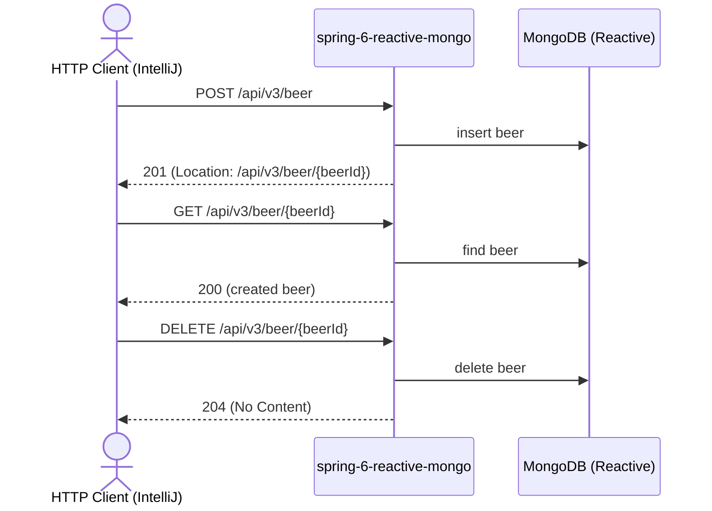

# beer Flow: createBeer → getBeer → deleteBeer

Datei: `restRequests/beer-flow-create-get-delete/beer-flow-create-get-delete.http`

## Ziel

Ein neues Bier anlegen, die erzeugte Ressource per GET prüfen und anschließend wieder löschen.

## Ablauf (Services)

## Requests (in dieser Reihenfolge)

1. `createBeer` – legt das Bier an und liest `beerId` aus dem `Location`-Header.
2. `getBeerById` – prüft, dass das Bier existiert und `beerName`/`beerStyle` übereinstimmen.
3. `deleteBeer` – löscht das zuvor erzeugte Bier (hinterlässt keine Testdaten).

## Benötigte Globals

|       Global        |         gesetzt von         |         genutzt von         |
|---------------------|-----------------------------|-----------------------------|
| `beerId`            | `createBeer`                | `getBeerById`, `deleteBeer` |
| `traceId`, `spanId` | `../scripts/traceparent.js` | alle Requests               |

## Asserts

- `createBeer` → `201` mit `Location`-Header.
- `getBeerById` → `200`, `beerName` = `Flow Beer`, `beerStyle` = `LAGER`.
- `deleteBeer` → `204`.

## Hinweise

- Basis-URL ist `{{application-port}}` (Profil `local` = 8083, `k8s` = 30083).
- Der `Location`-Header wird als relativer Pfad `/api/v3/beer/{id}` erzeugt; die ID wird über das letzte Pfadsegment
  extrahiert.
- `beerName` ist Pflicht (`@NotBlank`, 3–255 Zeichen); `beerStyle` ist optional (1–255 Zeichen). Die Mongo-`_id`
  wird als String (ObjectId) zurückgegeben.
- Der Flow ist wiederholbar: Das angelegte Bier wird am Ende gelöscht.
- Alle Requests benötigen ein Bearer-Token (`auth-id` aus `http-client.env.json`); dafür muss der Auth-Server auf
  Port `9000` laufen (siehe `docker compose up`).

