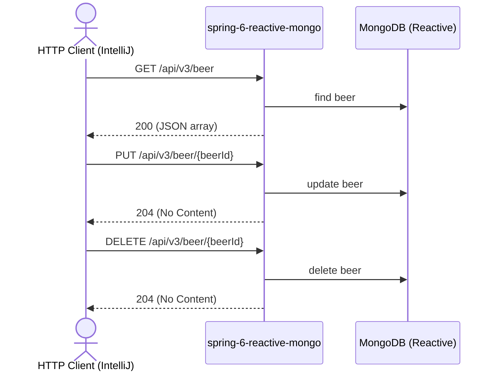

# beer Flow: listBeers → updateBeer → deleteBeer

Datei: `restRequests/beer-flow-list-update-delete/beer-flow-list-update-delete.http`

## Ziel

Ein bestehendes Bier aus der Liste auswählen, vollständig aktualisieren (PUT) und anschließend löschen.

## Ablauf (Services)

## Requests (in dieser Reihenfolge)

1. `listBeers` – speichert `beerId` (erstes Bier aus dem JSON-Array).
2. `updateBeer` – vollständiges Update (PUT) per `beerId`; das Pre-Request-Skript loggt die benutzte `beerId` und
   wirft einen Fehler, wenn sie nicht gesetzt ist.
3. `deleteBeer` – löscht das Bier per `beerId`.

## Benötigte Globals

|       Global        |         gesetzt von         |        genutzt von         |
|---------------------|-----------------------------|----------------------------|
| `beerId`            | `listBeers`                 | `updateBeer`, `deleteBeer` |
| `traceId`, `spanId` | `../scripts/traceparent.js` | alle Requests              |

## Asserts

- `listBeers` → `200`, mindestens ein Bier.
- `updateBeer` → `204`.
- `deleteBeer` → `204`.

## Hinweise

- Basis-URL ist `{{application-port}}` (Profil `local` = 8083, `k8s` = 30083).
- Die Collection wird als JSON-Array geliefert (kein HAL, kein `_embedded`).
- PUT ersetzt das Bier vollständig; `beerName` ist Pflicht (`@NotBlank`, 3–255 Zeichen), `beerStyle` ist optional
  (1–255 Zeichen). `id` und die Timestamps werden vom Server verwaltet und nicht im Body gesendet.
- `deleteBeer` liefert `204 No Content`; bei unbekannter `beerId` `404 Not Found`.
- Ohne vorheriges `listBeers` ist `beerId` leer → das Pre-Request wirft einen Fehler.
- Der Flow ist nicht wiederholbar: Das aktualisierte Bier wird am Ende gelöscht. Nach einem Neustart der Anwendung
  legt `BootstrapData` die Seed-Daten erneut an.
- Alle Requests benötigen ein Bearer-Token (`auth-id` aus `http-client.env.json`); dafür muss der Auth-Server auf
  Port `9000` laufen (siehe `docker compose up`).

